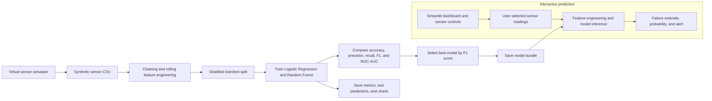
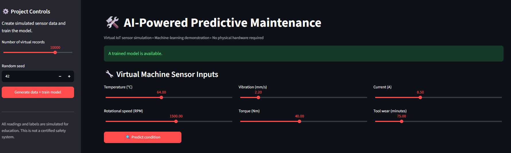
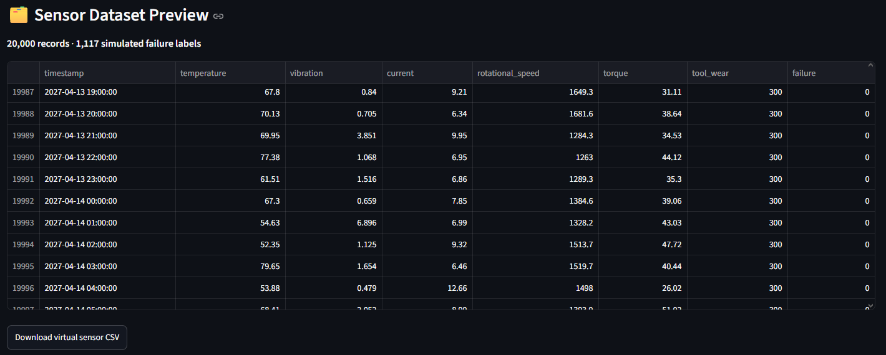
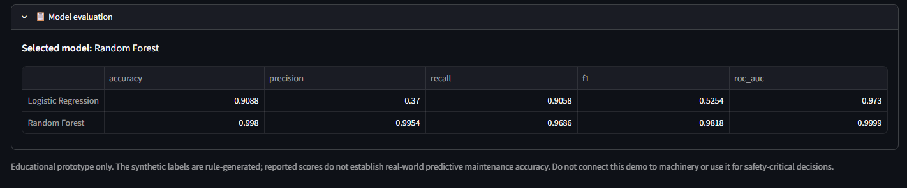
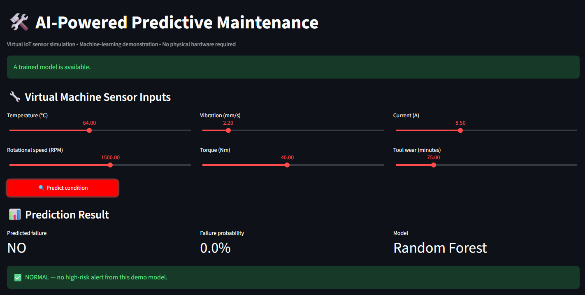
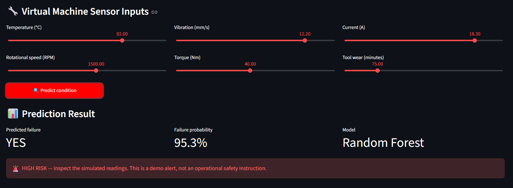
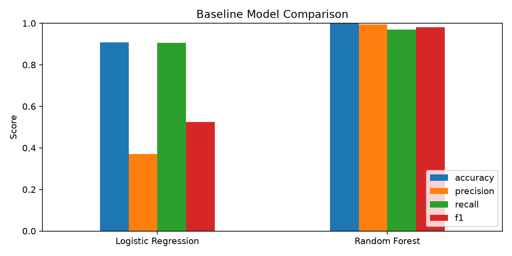
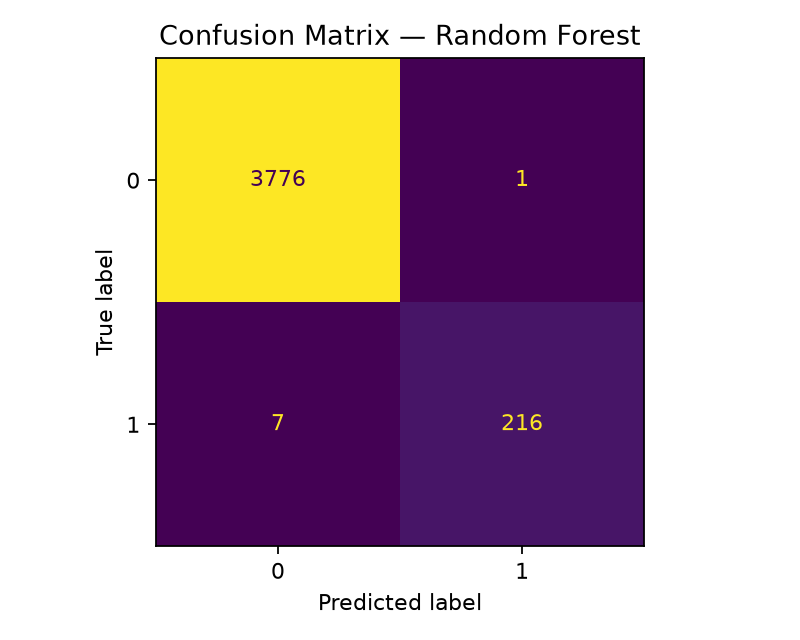

# AI-Powered Predictive Maintenance System for IoT Devices

A portfolio-ready, beginner-friendly machine-learning project that demonstrates how simulated IoT sensor readings can be used to estimate machine-failure risk. It includes a virtual sensor-data generator, model training and evaluation, a Streamlit dashboard, downloadable CSV data, and automated tests.

> **Scope and honesty:** This is an educational prototype. It uses simulated readings and labels created by transparent rules. It is not connected to physical IoT hardware, and its metrics do not demonstrate real-world failure prediction performance.

## Features

- Generates repeatable virtual sensor data for temperature, vibration, current, rotational speed, torque, and tool wear.
- Trains and compares Logistic Regression and Random Forest classifiers.
- Reports accuracy, precision, recall, F1-score, and ROC-AUC.
- Saves the selected model and evaluation artifacts.
- Provides a Streamlit dashboard for sensor controls and interactive predictions.
- Shows sensor trends, simulated label distribution, and a downloadable dataset.
- Includes small reproducibility tests with `pytest`.

## Architecture



## Tech stack

Python 3.11 or 3.12, Pandas, NumPy, scikit-learn, Matplotlib, Joblib, Streamlit, pytest.

## Project structure

```mermaid
flowchart TD
    root["AI-Predictive-Maintenance-IoT"]

    root --> app["app.py"]
    root --> main["main.py"]
    root --> requirements["requirements.txt"]
    root --> readme["README.md"]
    root --> gitignore[".gitignore"]

    root --> data["data"]
    data --> raw["raw"]
    raw --> rawkeep[".gitkeep"]
    data --> processed["processed"]
    processed --> processedkeep[".gitkeep"]

    root --> docs["docs"]
    docs --> architecture["architecture.md"]
    docs --> datasetnotes["dataset_notes.md"]

    root --> screenshots["Screenshots"]
    screenshots --> overview["01_Overview.png"]
    screenshots --> trends["02_Sensor_Trends&amp;Failure_Label_Dis.png"]
    screenshots --> preview["03_Sensor_Dataset_Preview.png"]
    screenshots --> evaluation["04_Model_Evalution.png"]
    screenshots --> normal["05_No_Risk_Pred.png"]
    screenshots --> highrisk["06_Hogh_Risk_Pred.png"]

    root --> models["models"]
    models --> modelkeep[".gitkeep"]

    root --> notebooks["notebooks"]
    notebooks --> notebookreadme["README.md"]

    root --> outputs["outputs"]
    outputs --> figures["figures"]
    figures --> figureskeep[".gitkeep"]
    outputs --> metrics["metrics"]
    metrics --> metricskeep[".gitkeep"]
    outputs --> predictions["predictions"]
    predictions --> predictionskeep[".gitkeep"]

    root --> src["src"]
    src --> init["__init__.py"]
    src --> simulator["simulator.py"]
    src --> train["train.py"]
    src --> predict["predict.py"]

    root --> tests["tests"]
    tests --> test["test_simulator.py"]
```



## Setup

### Windows PowerShell

```powershell
py -3.11 -m venv .venv
.\.venv\Scripts\Activate.ps1
python -m pip install --upgrade pip
pip install -r requirements.txt
```

If PowerShell blocks activation, use Command Prompt and run:

```bat
.venv\Scripts\activate.bat
```

### macOS / Linux

```bash
python3 -m venv .venv
source .venv/bin/activate
python -m pip install --upgrade pip
pip install -r requirements.txt
```

## Run the Streamlit app

From the project root, with the virtual environment activated:

```bash
streamlit run app.py
```

A local browser tab should open. In the left sidebar, click **Generate data + train model**. Wait for training to finish, adjust the virtual sensor sliders, and click **Predict condition**.

### Try a simulated failure

After training the model, set the dashboard sliders to these values and click **Predict condition**:

| Sensor | Value |
|---|---:|
| Temperature | 95 °C |
| Vibration | 7 mm/s |
| Current | 15 A |
| Rotational speed | 1,200 RPM |
| Torque | 60 Nm |
| Tool wear | 220 minutes |

The simulator's synthetic failure rule adds one point for each condition below. A reading is labeled as a failure when its score is at least 2:

| Condition | Score |
|---|---:|
| Temperature > 82 °C | +1 |
| Vibration > 5.2 mm/s | +1 |
| Current > 12 A | +1 |
| Tool wear > 180 minutes **and** torque > 45 Nm | +1 |

The example settings meet all four conditions. To calculate the synthetic label for a reading in Python:

```python
reading = {
    "temperature": 95,
    "vibration": 7,
    "current": 15,
    "rotational_speed": 1200,
    "torque": 60,
    "tool_wear": 220,
}

score = (
    int(reading["temperature"] > 82)
    + int(reading["vibration"] > 5.2)
    + int(reading["current"] > 12)
    + int(reading["tool_wear"] > 180 and reading["torque"] > 45)
)
synthetic_failure_label = int(score >= 2)
print(f"Score: {score}; synthetic failure label: {synthetic_failure_label}")
```

The dashboard prediction comes from a trained model, so it is an estimate and may not match the rule-generated label exactly. These settings are intended to produce a high-risk example in this demo, not to represent real machine behavior.

If you prefer the terminal workflow:

```bash
python main.py
streamlit run app.py
```

Run tests:

```bash
pytest -q
```

## Project screenshots

These screenshots show the Streamlit app and example dashboard states. The confusion-matrix screenshot is intentionally omitted here; the generated model evaluation charts are shown separately below.

### Dashboard and sensor controls



### Sensor trends and failure-label distribution


### Dataset preview



### Model evaluation in the dashboard



### Normal-risk prediction



### High-risk prediction



## Generated artifacts

After data generation and training, the project creates:

- `data/raw/virtual_sensor_data.csv` — simulated sensor data.
- `models/predictive_maintenance.joblib` — trained model bundle.
- `outputs/metrics/model_metrics.json` — baseline evaluation metrics.
- `outputs/predictions/test_predictions.csv` — held-out predictions.
- `outputs/figures/confusion_matrix.png` — confusion matrix.
- `outputs/figures/model_comparison.png` — baseline comparison chart.

The generated dataset, trained model, metrics, and prediction CSV are ignored by Git by default. The two evaluation PNGs are kept as README visuals; training regenerates them.

## Model evaluation output charts

The charts below are generated by training the models. They are evaluation outputs, not screenshots of the dashboard.

### Baseline model comparison



### Confusion matrix



## Dataset option for future improvement

For a more realistic experiment, compare this simulator against the public **AI4I 2020 Predictive Maintenance Dataset** from the UCI Machine Learning Repository:

https://archive.ics.uci.edu/dataset/601/ai4i+2020+predictive+maintenance+dataset

Keep its real dataset columns and failure labels separate from the simulator's schema, and document all preprocessing choices. Do not mix synthetic labels and public dataset labels without clearly explaining the difference.

## Important limitations

- The default dataset is synthetic and its labels are generated from fixed thresholds.
- High evaluation scores can reflect the simplicity of those rules rather than genuine predictive ability.
- The random train/test split is for a compact teaching example; rigorous time-series evaluation should use chronological splits and leakage-aware feature engineering.
- A displayed probability is a model score, not a calibrated guarantee of failure.
- Do not use this prototype to control machinery or make safety-critical maintenance decisions.
